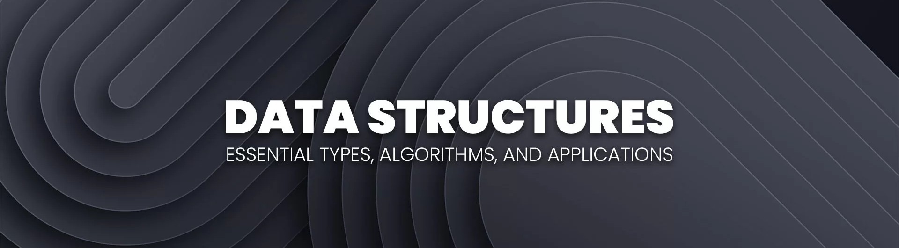

# CPE 010 CPE21S1 - Data Structures and Algorithms - Medina

<div class="image-container">
    
</div>

## Overview
This is a course repository for my CPE 010 - Data Structures and Algorithms Class. The repository shall contain all of my laboratory activities, assignments, seatworks, and exercises for the course and shall serve as a record of all of my work throughout the entirety of the semester.

---

## Course Info

- **Course:** CPE 010 - Data Structures and Algorithms
- **Section:** CPE21S1
- **Student:** Medina, Jomz Ryle E.
- **Instructor:** Engr. Jimlord Quejado
- **School:** Technological Institute of the Philippines Quezon City (TIP QC)

---

## Repository Structure (up-to-date and completed as of 22/10/2026)

```
├── Assignment Outputs/
├── Lab Activities/
  └── FINALS
    └── HOA 10.1 - Graphs
    └── HOA 11.1 - Basic Algorithm Analysis
    └── HOA 13.1 - Parallel Algorithms and Multithreading
    └── HOA 14.1 - Algorithm Complexity
  └── MIDTERMS
    └── HOA 6.1 - Searching Techniques
    └── HOA 7.1 - Sorting Algorithms Pt1
    └── HOA 8.1 - Sorting Algorithms Pt2
    └── HOA 9.1 - Tree ADT
  └── PRELIMS
    └── HOA 1.1 - Basic C++ Programming
    └── HOA 2.1 - Arrays, Pointers and Dynamic Memory Allocation
    └── HOA 3.1 - Linked Lists
    └── HOA 4.1 - Stacks
    └── HOA 5.1 - Queues
├── Media/
  └── Images
    └── banner.jpg
├── Project Files/
└── README.md
```

## Topics Covered:

PRELIM:
- Course Introduction: TIP Vision and Mission; TIP Graduate Attributes/Institutional Learning Outcomes; Program Educational Objectives / Student Outcomes; Course Syllabus and Course Requirements; Orientation for Industry and Laboratory Software and Tools.
- Introduction to Data Structures and Algorithm Analysis: C++ Programming Review, Abstract Data Types, Space and Time Complexity, Algorithm Analysis Techniques
- Arrays and Linked Lists: Dynamic Memory Allocation, and Singly, Doubly and Circular Linked Lists
- Stacks: Stack using Array, Stack using Linked Lists, Implementation in C++, Problem Solving

MIDTERMS:
- Queues: Queues using Arrays, Queues using Linked Lists, Implementation in C++, Problem Solving
- Searching Techniques: Linear Search, Binary Search, Hashing
- Sorting Algorithms: Basic Sorting Algorithms

FINALS:
- Tree ADT; General and Binary Search Trees; AVL Tree; Traversal Algorithms; Solving Problems using Trees.
- Graph ADT; Adjacency Matrix and Adjacency List; Breadth-First Search; Depth-First Search; Solving Problems using Graphs.
- Basic Algorithm Analysis; Theoretical and Experimental Methods in Measuring Time; Time Complexity Classes.


